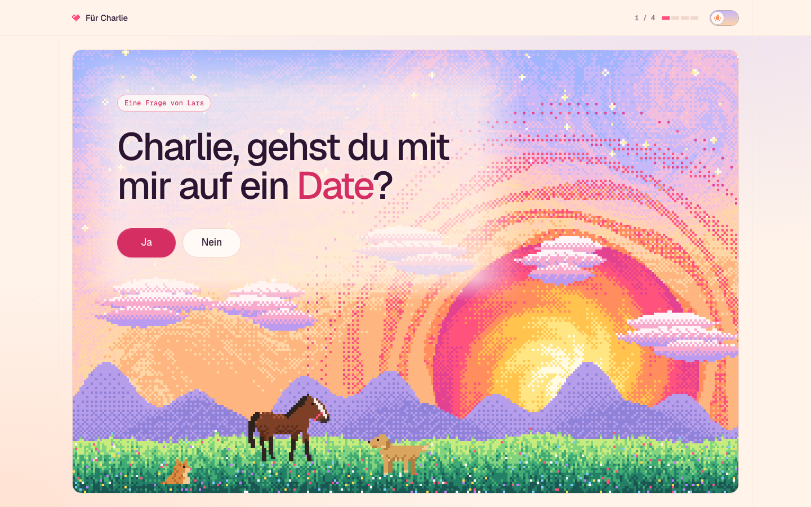
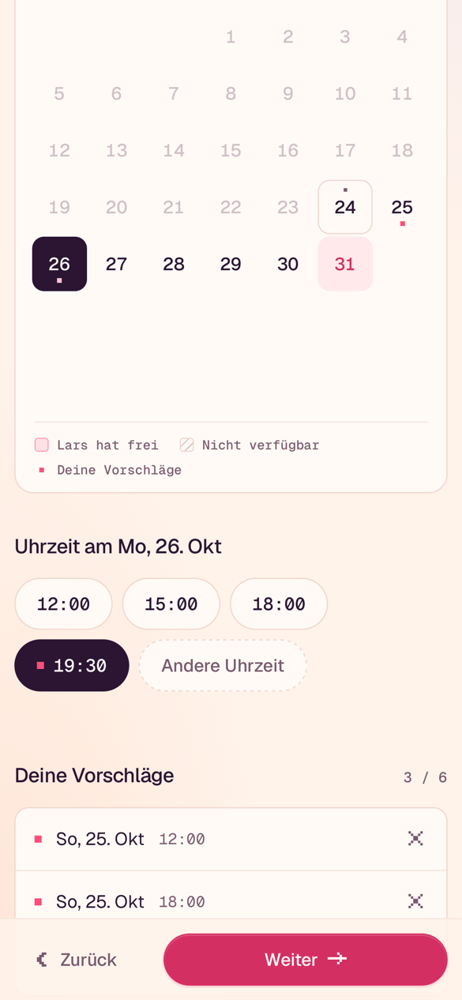
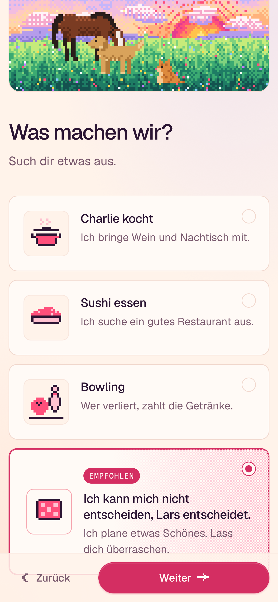
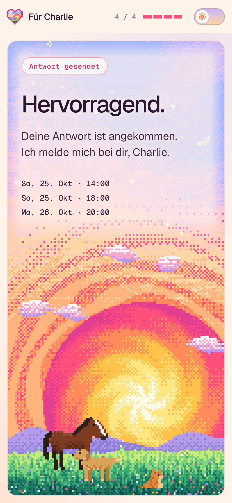

# Für Charlie

A single-page date invitation: a dithered pixel-art meadow (Lewin the horse, a cat, a dog) above a
four-step flow (question → when → what → note). Answers go to Lars' inbox via Web3Forms. Vanilla
TypeScript, one canvas, no runtime dependencies. All visible copy is German and lives in
[`config.ts`](config.ts).

```sh
nvm use            # Node 24 LTS (.nvmrc); >= 22.12 works
npm ci
npm run dev        # http://localhost:5173/charlie/
```

**Before sending the link:** replace the placeholder schedule in `config.ts` (marked
`PLACEHOLDER`), set `WEB3FORMS_ACCESS_KEY`, set `DRY_RUN: false`, run `npm run og` if you changed
palette or texts, then push to `main`.



<p>
  
  
  
</p>

---

## Architecture

```
config.ts                 everything personal: names, texts, palette, schedule, activities, key
index.html                static shell; <head> is completed at build time (vite.config.ts)
vite.config.ts            base path from SITE_URL, head injection (meta, OG, palette vars, font preload)
src/
  main.ts                 boot: store, scene, fx, theme switch, step router, focus + aria-live
  theme.ts                light/dark: system preference until switched, then remembered
  state.ts                typed store, defensive restore, localStorage persistence
  dates.ts                calendar-day arithmetic on 'YYYY-MM-DD', Berlin wall clock, de-DE formatting
  schedule.ts             day availability (bounds, blocked, highlighted) and slot set operations
  submit.ts               Web3Forms payload + POST (timeout, success semantics, DRY_RUN)
  validate-config.ts      dev-time config validation (console warnings)
  dom.ts                  10-line element factory
  icons.ts                16x16 / 8x8 pixel icons rendered as SVG <rect> runs
  steps/
    common.ts             App context, step header/footer, *accent* markup
    question.ts, nein.ts  step 1 and the unpressable button
    when.ts, calendar.ts  step 2: ARIA date grid, time chips, slot list
    what.ts               step 3: activity cards (radio or checkbox)
    note.ts               step 4: note, summary, submission, error/retry
    done.ts               success screen
  scene/
    engine.ts             rAF loop, sizing, input, actor orchestration
    pixels.ts             integer device-pixel scaling for canvases
    backdrop.ts           dithered sun/grain/meadow + scatter particles
    sprite.ts             Frame/Palette/Animation primitives, strokes, legs, gaits, blit, dither
    actor.ts              Actor + state machine + movement helpers
    heart.ts              heart sprite and floating-heart particles
    fx.ts                 viewport overlay: "Nein" dissolve, "Ja" burst
    animals/              lewin.ts, cat.ts, dog.ts
scripts/og.ts             renders public/og.png and public/apple-touch-icon.png
tests/unit, tests/e2e     Vitest and Playwright
```

Data flow is one-directional: steps read and write the `Store` (`get` / `set` / `subscribe`);
`main.ts` subscribes and swaps the step view when `step` changes. Each step builds its own DOM
once and re-renders only its sub-panels. There is no framework; the whole app is ~18 KB gzipped
JS.

### Layout

One stage card (`<section class="stage">`) holds the canvas. Steps 1 and 5 are "hero" steps: the
content is overlaid on the stage (`main[data-hero]`), which fills the viewport. Steps 2–4 shrink
the stage to a strip (CSS height transition; the scene re-lays itself out every resize) and render
below it, with a sticky footer carrying the primary action. Resumed sessions set
`html[data-boot]` in an inline pre-paint script so the first paint already has the right stage
height (CLS 0 on cold and resumed loads).

**Theme** (`theme.ts`): the same pre-paint script sets `html[data-theme]` from the stored switch
choice or `prefers-color-scheme`, so dark mode never flashes light. Until the switch in the top
bar is used, the page follows system changes live; afterwards the choice is stored. A change
repaints the scene and FX canvases in the other palette.

---

## Scene engine

### Rendering

- The canvas backing store is the **scene resolution** (≈ 1 scene px per 4 CSS px on desktop, 3 on
  phones). `pixels.ts` picks `device = round(cssPixel × devicePixelRatio)` physical pixels per
  scene pixel and sets the CSS size to `w × device / dpr`, so the browser upscales by an exact
  integer with `image-rendering: pixelated`. Crisp at DPR 1, 2, 3 and odd zoom levels.
- Each frame: copy the static paper layer (`Uint32Array.set`), plot scatter particles, blit actors
  (sorted by lane), blit hearts, one `putImageData`. No `drawImage` scaling, no per-pixel canvas
  API calls. ~50k pixels per frame on desktop; a steady 60 fps.
- The loop stops on `visibilitychange` and restarts with a fresh clock (no dt spike).
- `prefers-reduced-motion`: no pointer scatter, slower animals, no trot, the cat does not chase,
  single hearts, instant step transitions.

### Backdrop (`backdrop.ts`)

Generated once per resize, deterministic (ordered dither + hashed noise, no `Math.random`), so
resizes never flicker:

A painting in ordered dither: every surface picks between two neighboring stops of a palette
list (`sky`, `sun`, `meadow`, …) with an 8×8 Bayer threshold.

- **Sky** (static): a vertical ramp sampled through three swirls and a sine flow, so the bands
  bend like Van Gogh brush strokes; warmed around the sun; short color dabs follow the swirl.
- **Halo** (static): wobbling concentric rings in the sun's outer colors.
- **Hills** (static): two silhouettes the sun sets behind.
- **Sun**: ringed disc, core to rim. Its placement interpolates continuously between hero (large,
  resting on the horizon) and strip (small cap peeking over the meadow), so the stage can animate.
- **Clouds**: stacks of tapered brush strokes, highlight on top, shadow below.
- **Meadow**: banded stripes with blade streaks and flower dabs, rolling horizon, grass blades.
- **Sparkles**: stars (with crosses for the bright ones) and some flowers twinkle.

Every pixel of the non-static layers is a **particle** (struct-of-arrays typed arrays): a spring-damper pulls
it home, the pointer pushes it away within an 11 px radius. Settled particles cost one branch.

### Sprite format (`sprite.ts`)

A `Frame` is `{ w, h, px: Uint32Array }` in ImageData byte order (`0xAABBGGRR`, little-endian), 0 =
transparent. Sprites are authored as character grids mapped through a palette:

```ts
// prettier-ignore
const SIT = [
  '.......o...o....',
  '.......oo.oo....',
  '......ooookoo...',   // o orange, O stripes, l cream, k eye, p nose
];
const pal = palette({ o: '#DD8A3E', O: '#B8652A', l: '#F5C893', k: '#2A1D1A', p: '#E8638C' });
const frame = paint(createFrame(16, 12), SIT, pal);
```

Composition happens once at startup, so the render loop only ever sees bitmaps:

- `paint(frame, rows, palette, dx, dy)`: paint a grid (unknown chars are transparent).
- `stroke(frame, points, width, color)`: round-brush polyline (tails, limbs).
- `recolor(frame, from, to)`: derive variants, e.g. a blink frame (eye → coat).
- `drawLeg(frame, LegSpec, LegPose)`: two-segment leg (hip → knee → foot) with an optional
  2 px hoof/paw.
- `gait(phases, stride, count)`: samples a cyclic gait into per-leg poses. A gait is just a phase
  offset per leg: lateral walk `[0.5, 0, 0.75, 0.25]`, trot (diagonal pairs) `[0, 0.5, 0.5, 0]`.

Bodies are drawn without legs and tails; every gait and tail position reuses one body drawing.
Order: far legs → body → tail → near legs. Far legs use the shade color for depth.

`Animation` is `{ frames, durations, loop }`; `sequence([[frame, seconds], ...])` for hand-timed
idles (blinks, tail flicks), `animation(frames, fps)` for uniform cycles.

### Actors and state machines (`actor.ts`)

```ts
interface ActorSpec {
  name: string;
  anims: Record<string, Animation>;
  states: Record<string, StateDef>; // { anim, enter?(a, w), update?(a, w, dt) => nextState | undefined }
  initial: string;
  lane: number; // feet y = horizon + lane; higher lanes draw in front
  onTap?: string; // state entered when tapped
  onCelebrate?: string; // state entered on "Ja"
}
```

`Actor.update` advances time, applies hop physics (`z`, `vz`, gravity), runs the current state's
`update` and transitions if it returns a state name (`enter` runs on every transition). `World`
exposes size, horizon, last pointer x (mouse hover or last tap), `happy` (success screen),
`hearts()`, `random()` and `reducedMotion`. Helpers: `moveTo`, `randomX`, `clampX`, `between`,
`hop`.

| Animal | States                       | Notes                                       |
| ------ | ---------------------------- | ------------------------------------------- |
| Lewin  | idle, walk, trot, graze, hop | tap / Ja: hop + hearts; success: hops often |
| Cat    | sit (blinks), run, pounce    | chases `pointerX`, sits when it arrives     |
| Dog    | idle, wag, trot, sniff, hop  | wags often; success: wag ↔ hop loop         |

**Add an animation**: build frames (paint / stroke / recolor / gait), add them to `anims`, add a
state that uses it and return its name from another state's `update` (or `onTap`).

**Add an animal**: create `scene/animals/<name>.ts` exporting `create<Name>(x): Actor` with its
own grids, palette, legs and states, then add it to the `actors` array in `engine.ts`'s
`resize()`. Hit-testing, sorting, flipping and hearts work automatically.

### FX overlay (`fx.ts`)

A fixed, click-through, viewport-sized canvas at 3 CSS px per pixel whose loop only runs while
particles exist. `dissolve(el)` draws a miniature of the element (fill, border, label, via
`getComputedStyle`) into an offscreen canvas and turns each opaque pixel into a drifting particle;
`burst(el)` emits accent pixels and hearts. Fades are dithered (Bayer threshold vs. remaining
life) instead of alpha-blended, matching the art.

---

## The "Nein" button (`steps/nein.ts`)

Decided per event by `pointerType`, not media queries (hybrid devices do the right thing per
input):

- **Mouse**: on `pointermove` within 100 px (and nearer to Nein than to Ja, so reaching for Ja
  never counts), it is re-parented to `<body>` (so `position: fixed` is viewport-relative inside
  animated ancestors) and jumps via `translate` to a spot from `pickSpot`: inside the painting
  (the stage, clipped to the viewport) with a 16 px margin, not overlapping Ja, the headline or
  the quip (inflated 12 px), ≥ 220 px from the
  cursor when possible. It is click-through during the 350 ms flight; a cooldown counts one
  attempt per approach.
- **Touch / pen**: `pointerdown` → `preventDefault`, a puff of pixels stays behind and the button
  jumps to a new spot (same `pickSpot` as the mouse), so it can be chased forever.
  `touchend` is prevented so no synthetic click is generated.
- **Keyboard / AT**: focus → escape and focus moves to Ja; Enter/Space are swallowed.
- **Everything**: a capture-phase `click` listener on `window` cancels any click targeting it.
- Reduced motion: no flight and no pixel puff; it reappears at the new spot instantly.

Each escape increments `neinCount` (persisted, reported in the email) and scales Ja by 3.5 %
(max 1.35, `transform` only). The scale counts this page view's escapes only, so a reload resets Ja.

---

## config.ts reference

| Key                          | Type                                                         | Purpose                                                                                                            |
| ---------------------------- | ------------------------------------------------------------ | ------------------------------------------------------------------------------------------------------------------ |
| `names.her` / `me` / `horse` | string                                                       | Used in texts.                                                                                                     |
| `SITE_URL`                   | absolute URL, trailing `/`                                   | OG/Twitter absolute URLs; its **path is the Vite `base`** (must be `/<repo>/`).                                    |
| `WEB3FORMS_ACCESS_KEY`       | string                                                       | Public by design. Placeholder `YOUR_ACCESS_KEY`.                                                                   |
| `DRY_RUN`                    | boolean                                                      | Log the payload to the console instead of sending.                                                                 |
| `palette` / `paletteDark`    | `Palette`                                                    | Light / dark UI + scene colors, injected as CSS custom properties (`--rose-ink`, `--sky-0`).                       |
| `horse`                      | `HorseColors`                                                | Lewin's coat, highlight, shade, points, blaze, muzzle.                                                             |
| `minDate` / `maxDate`        | `'YYYY-MM-DD'`?                                              | Default today / today + 3 months. `minDate` never undercuts today.                                                 |
| `blockedDates`               | `{date, reason?}` \| `{from, to, reason?}`                   | Inclusive ranges; hatched, focusable, reason shown on hover/focus/tap.                                             |
| `highlightedDates`           | `{date, label, from?}`                                       | Accent styling, label above the day's chips. `from` (`'HH:MM'`): earlier presets and custom times are not offered. |
| `blockedWeekdays`            | ISO weekday numbers (1 = Mon)                                | Never selectable.                                                                                                  |
| `timePresets`                | `'HH:MM'[]`                                                  | Chips per day (from a highlight's `from` on); plus "Andere Uhrzeit" (custom input, 5 min steps).                   |
| `maxSlots`                   | positive int                                                 | Max date+time proposals.                                                                                           |
| `activities`                 | `Activity[]`                                                 | `{ id, title, description, icon, recommended?, badge? }`. Ids are persisted: never reuse.                          |
| `activities[].icon`          | `'pot' \| 'sushi' \| 'bowling' \| 'dice' \| 'heart'` or rows | Custom icon: 16 rows of `#` ink, `+` accent, `o` blush, `.` transparent.                                           |
| `allowMultiple`              | boolean                                                      | Radio vs. checkbox cards.                                                                                          |
| `texts`                      | `Texts`                                                      | Every visible string. `*word*` renders a word in the accent color (headlines).                                     |

`validateConfig` (dev only, console `[config]` warnings, unit-tested) flags: invalid dates, inverted
ranges, min > max, days both blocked and highlighted (blocked wins), duplicate highlights, bad
weekdays, all weekdays blocked, invalid/duplicate presets, `maxSlots < 1`, empty or duplicate
activities, more than one recommended, missing key (louder when `DRY_RUN` is false), non-absolute
or slash-less `SITE_URL`, non-`#RRGGBB` colors.

---

## Dates and time zones

- A day is a `'YYYY-MM-DD'` string. Days are **never** parsed with `new Date('2026-10-31')` (that is
  UTC midnight, the previous day west of Greenwich). `dates.ts` maps days to integer day numbers
  via `Date.UTC` and does all arithmetic on integers, so DST cannot shift a day.
- The only conversion from an instant to a day is `todayIn(now, 'Europe/Berlin')` (and
  `nowTimeIn`), via `Intl.DateTimeFormat#formatToParts`. "Today", past days and past times on today
  are Berlin's, whatever the viewer's zone.
- Formatting renders a day as UTC noon in `timeZone: 'UTC'` with `de-DE`, which prints exactly that
  calendar day. Short labels use format-context abbreviations with dots stripped
  (`Sa, 31. Okt`, `Mo, 1. März`).
- The submission time is formatted in Europe/Berlin (`Samstag, 24. Oktober 2026 um 14:05 Uhr`).
- `addMonths` clamps to month end (Jan 31 + 1 → Feb 28/29). The calendar grid is always 6×7 (no
  height jump between months).
- Tests cover both 2026 DST switches, year/month edges, leap years, pre-epoch weekdays.

## Persistence

`state.ts` stores `{ step, slots, activities, note, neinCount }` under `localStorage['fuer-charlie:v1']`
on every change (all access in `try/catch`; private modes just lose persistence). Restore is
defensive: malformed data is dropped, slots that became past or blocked are removed, unknown
activity ids are dropped, the note is capped, and the step falls back if its prerequisites
vanished. Reaching step 5 removes the key, so a later visit starts fresh.

## Web3Forms

- `POST https://api.web3forms.com/submit`, JSON body, `Content-Type` and `Accept`
  `application/json`.
- Success **only** if the response body has `success: true` (Web3Forms reports some failures as
  200 + `success: false`, others as non-2xx with JSON or HTML bodies). 15 s `AbortController`
  timeout. Failures resolve to `{ ok: false, reason }`; the UI shows an inline error and turns the
  primary button into "Erneut versuchen". Inputs stay in the store and in localStorage.
- Payload: `access_key`, `subject` ("Charlie hat geantwortet"), `from_name` ("Date-Website"),
  `botcheck` (the hidden honeypot checkbox Web3Forms documents; their docs now mark it deprecated in
  favor of captchas, which are a Pro feature, and it is plenty for a link sent to one person) and a
  plain-text German `message` with every slot (`Samstag, 31. Oktober 2026 um 19:30 Uhr`), activity,
  note, Nein attempts and submission time.
- Double submission is prevented (busy flag + disabled button, `aria-busy`).
- The access key is public by design: it can only send to the inbox it was created for. The free
  plan has a monthly submission cap (check [web3forms.com](https://web3forms.com) for the current
  number); "Restrict to Domain", captchas, file attachments, autoresponders and webhooks are Pro
  features, so on the free plan anyone who reads the key could send mail to that inbox. This site
  sends exactly one submission per completed flow.

## Scripts

| Script              | What                                                         |
| ------------------- | ------------------------------------------------------------ |
| `npm run dev`       | Vite dev server (config warnings in the console)             |
| `npm run build`     | Production build to `dist/`                                  |
| `npm run preview`   | Serve `dist/` on :4173                                       |
| `npm run typecheck` | `tsc --noEmit` (strict, `noUncheckedIndexedAccess`)          |
| `npm run lint`      | ESLint (`strictTypeChecked`, zero warnings) + Prettier check |
| `npm run format`    | Prettier write                                               |
| `npm run test`      | Vitest unit tests                                            |
| `npm run test:e2e`  | Playwright (builds an e2e bundle, serves it on :4174)        |
| `npm run og`        | Regenerate `public/og.png` and `public/apple-touch-icon.png` |

## Testing

- **Unit (Vitest, Node)**: `dates` (DST, month/year edges, Berlin wall clock, German formats),
  `schedule` (bounds, blocking, slot ops, sanitizing), `validate-config` (every rule, plus "the
  shipped config is valid apart from the key"), `submit` (payload text, success semantics, HTTP and
  network failures, timeout, DRY_RUN), `state` (defensive restore), `nein.pickSpot` (viewport,
  protected rects, pointer distance).
- **E2E (Playwright)**: projects `webkit-iphone` (390×844, touch, mobile) and
  `chromium-desktop` (1440×900). Tests derive dates from `config.ts` and the real clock, so they
  survive schedule edits (the blocked-date test skips if no blocked day is in range). Covered: full
  happy path with DRY_RUN (payload asserted from the console, zero network calls, storage cleared),
  Nein escaping the mouse six times (in viewport, no overlap, focus handoff), Nein vanishing on
  touch, zero clicks reaching Nein (window capture counter), blocked and past days, multiple slots
  incl. same day and custom-time duplicates, keyboard calendar, persistence across reload, error
  state + retry against a mocked API (headers and body asserted).
- **e2e mode**: `vite build --mode e2e` enables `window.__CHARLIE_DRY_RUN__` to override
  `DRY_RUN` per test. The check is behind `import.meta.env.MODE === 'e2e'`, a build-time constant,
  so production bundles contain no trace of it.
- **Screenshots**: `SCREENSHOTS=1 npm run test:e2e -- screenshots` writes every step (incl. the
  error state) for both projects to `test-results/screens/`.

## Deployment (GitHub Pages)

1. The repo name must match the path of `SITE_URL` (`https://<user>.github.io/<repo>/`); the Vite
   `base` is derived from it. Renaming the repo = changing `SITE_URL`.
2. GitHub → Settings → Pages → Build and deployment → Source: **GitHub Actions**.
3. Push to `main`. [`.github/workflows/deploy.yml`](.github/workflows/deploy.yml) runs typecheck,
   lint, unit tests and build, then `configure-pages` → `upload-pages-artifact` → `deploy-pages`.
   Actions are pinned to commit SHAs (tag in a comment); Node comes from `.nvmrc`.
4. OG previews (iMessage, WhatsApp) cache aggressively; regenerate `og.png` before the first share.

## Known limitations

- **Everything in `config.ts` is public**, in the repo and in the bundle, including the schedule
  and its reasons. `noindex` keeps search engines away, nothing more.
- No server: the only "backend" is Web3Forms; there is no confirmation email to Charlie and no
  dedupe if she completes the flow twice on two devices.
- The cat follows x only (it lives on the meadow); pointer scatter needs a hovering pointer or a
  touch drag over the stage.
- Light theme only by design.
- Browsers without `image-rendering: pixelated` fall back to `crisp-edges` or smooth upscaling;
  still functional, less crisp.
- The Nein dissolve rasterizes the label at one pixel per 3 CSS px; it reads as button bits, not
  letters.
